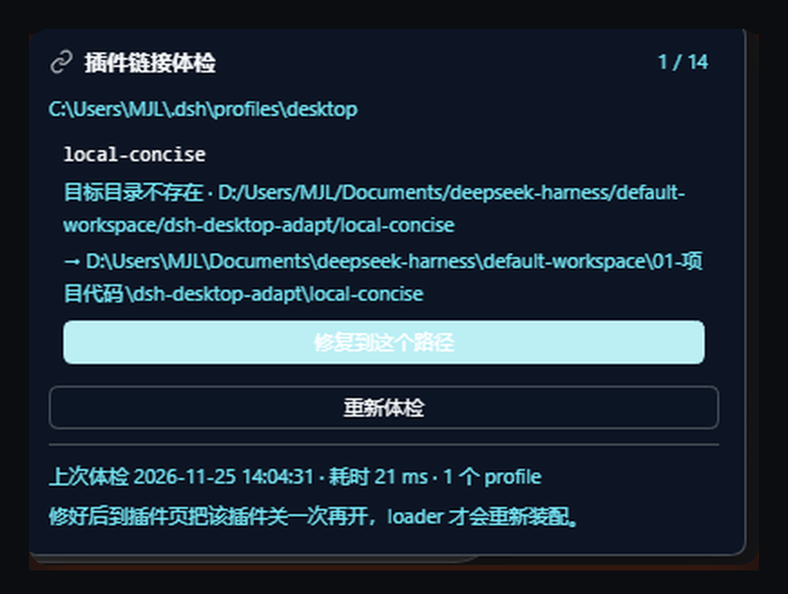

[中文](README.md) | [English](README.en.md)

# 插件链接体检 · dsh-link-guard



输入框右边出现「1 条异常」时点开就是这块：坏的插件、原路径、推断出的新路径、修复按钮。一切正常时不出现。

启动时自动检查每个 DSH profile 里用 `link:` 装的插件，看它们是否还连得上工作区目录。发现坏链就在输入框下方出现一颗胶囊，点开能看到是哪个插件、能不能一键修。

## 要解决的问题

`link:` 装进 profile 的插件是指向工作区目录的**软链接**。那个目录一旦被移动、改名或删除，插件会**静默失效**：

| 现象 | 实际含义 |
| --- | --- |
| `list_bundles` 显示 `installed: true` / `enabled: true` | 看起来一切正常 |
| `rows[]` 里缺 `entryId` | **真正的故障信号** |
| loader 里没有对应行 | 插件没在跑 |
| 界面 | 不报错、不提示，功能就是没了 |

2026-11-25 踩过一次：整理工作区把 4 个插件移进 `01-项目代码/`，`local-concise`、`local-token-speed`、`hanbao-balance`、`local-set-default-model` 同时失效，全程零提示，直到发现输入框下方那排东西不见了才察觉。

## 它做什么

| 时机 | 动作 |
| --- | --- |
| DSH 启动后 1.2 秒 | 体检所有 profile，结果写日志（可用 `logOnBroken` 关掉） |
| 发现坏链 | 输入框下方出现 `N 个插件链接异常` 胶囊，点开是面板 |
| 一切正常 | 胶囊**完全不出现**，不占位置 |
| 面板里点「修复到这个路径」 | 备份 `package.json` → 改 `link:` 路径 → `pnpm install` → 自动复检 |
| 面板里点「重新体检」 | 立刻重跑一次 |

修复只处理**能推断出新位置**的坏链（目标目录被移动到别处）；推断不出的、以及其它异常状态，只报告、不猜。

## 检测的六种状态

| 状态 | 含义 |
| --- | --- |
| `ok` | 目标在、链接在、`main` 入口与 `bundle patch` 都齐 |
| `broken-target` | 目标目录不存在（被移动 / 改名 / 删除） |
| `not-linked` | 目标在，但 `node_modules` 里没链接（需要 `pnpm install`） |
| `empty-placeholder` | 链接在但缺 `package.json` |
| `incomplete` | 包在，但 `main` 或 `dsh.bundle.patch` 指的文件不存在 |
| `not-declared` | 写进 `dsh.profile.bundles` 但 `dependencies` 没有（官方 `@deepseek-ai/*` 自动豁免） |

## 坏链位置推断

对 `broken-target`，以旧路径的盘符根、`<盘符>/Users/<用户名>`、旧路径共同祖先、`$HOME` 为起点做**有界广度搜索**（最多 6 层、`searchBudget` 个目录，跳过 `node_modules`/`.git`/`AppData` 等），找同名且含 `package.json` 的目录，按**路径尾部匹配层数**排序取最佳。

实测：`…/default-workspace/hanbao-balance` → `…/default-workspace/01-项目代码/hanbao-balance`。

## 接口

| 路由 | 说明 |
| --- | --- |
| `GET /dsh-link-guard/state` | 当前体检结果（所有 profile、每个插件的状态与建议） |
| `GET /dsh-link-guard/check?profiles=all` | 立即复检，返回新结果 |
| `GET /dsh-link-guard/fix?profile=<名>&name=<插件>` | 修复一个坏链；`200` 成功、`409` 不能自动修（带原因） |
| `GET /dsh-link-guard/plan?src=<目录>&dst=<目录>` | 搬家预演：列出会被这次移动影响的链接 |

## 命令行

```bash
dsh-link-guard                       # 体检全部 profile
dsh-link-guard --profile desktop     # 只查一个
dsh-link-guard --quiet               # 只报异常
dsh-link-guard --json                # 机器可读
dsh-link-guard --fix                 # 自动改路径 + pnpm install
dsh-link-guard --fix --dry-run       # 只看会改什么
dsh-link-guard --plan SRC DST        # 搬家前预演
```

退出码：`0` 全好 / `1` 有坏链 / `2` 用法错误 / `3` `--plan` 判定会坏。

CLI 与插件共用同一份扫描内核 [`lib/link-scan.mjs`](../lib/link-scan.mjs)，不会各写一套。

## DSH Go（手机）

输入框上方一行状态条：`链接 13 正常` / `链接 2 坏`（24 字预算内取舍，异常时橙色）。点开是「插件链接体检」面板：异常数 / 总数、上次体检时间与耗时、逐条异常（可修复的标「可修复」）、底部「重新体检」按钮。

## 配置

```yaml
- name: '@local/dsh-link-guard'
  config:
    checkOnBoot: true        # 启动时自动体检
    profiles: all            # all，或 "desktop,web" 这样的逗号列表
    searchBudget: 4000       # 坏链定位最多访问多少目录
    logOnBroken: true        # 发现异常时写一行 warn 日志
```

## 修完之后

改路径只是文件层。DSH 的 loader 不会自己重新装配，**必须去插件页把该插件关一次再开**（或重启 dsh）。判断恢复没有：`list_bundles` 里那条的 `rows[]` 重新有了 `entryId`。面板里的提示也是这么写的。

## 测试

```bash
node tests/host.test.mjs
```

用假 `ctx` 跑 `apply()`，在临时目录搭三个 fixture profile（好链 / 坏链 / 只声明 bundle），断言 15 项：识别坏链、推断新位置、拒绝猜不出路径的修复、真正修一次并检查备份文件、`plan` 列出影响、状态条文案在 24 字内、视图结构合法等。

## 已知限制

- 推断靠同名目录 + 路径尾部相似度，改名的情况（插件目录本身被改名）找不到，只能手工改。
- 体检是同步遍历，profile 多、目录深时会占用一点启动时间；实测 4 个 profile 约 10 ms。
- `pnpm install` 超时 120 秒，超时会在面板里如实报错并给出可复制的手工命令。
